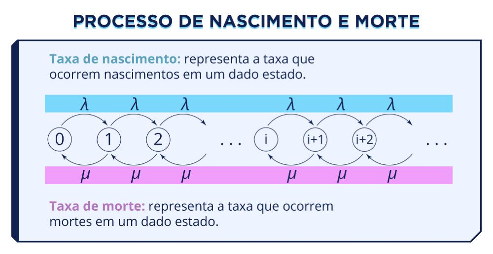
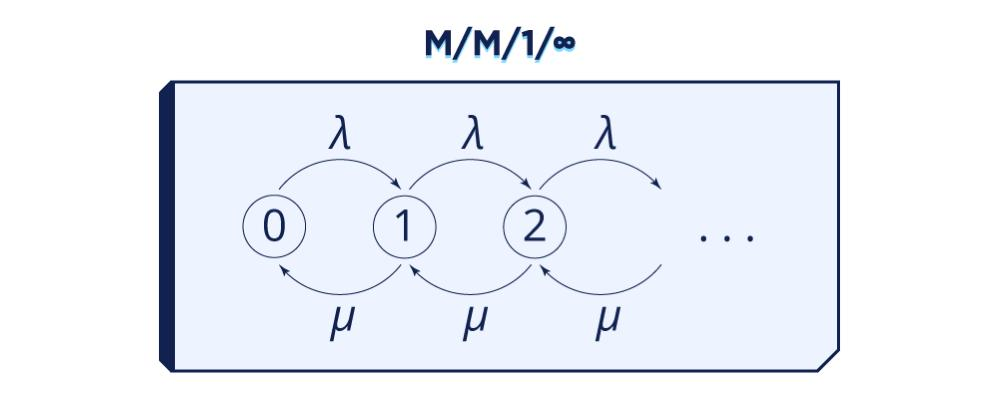
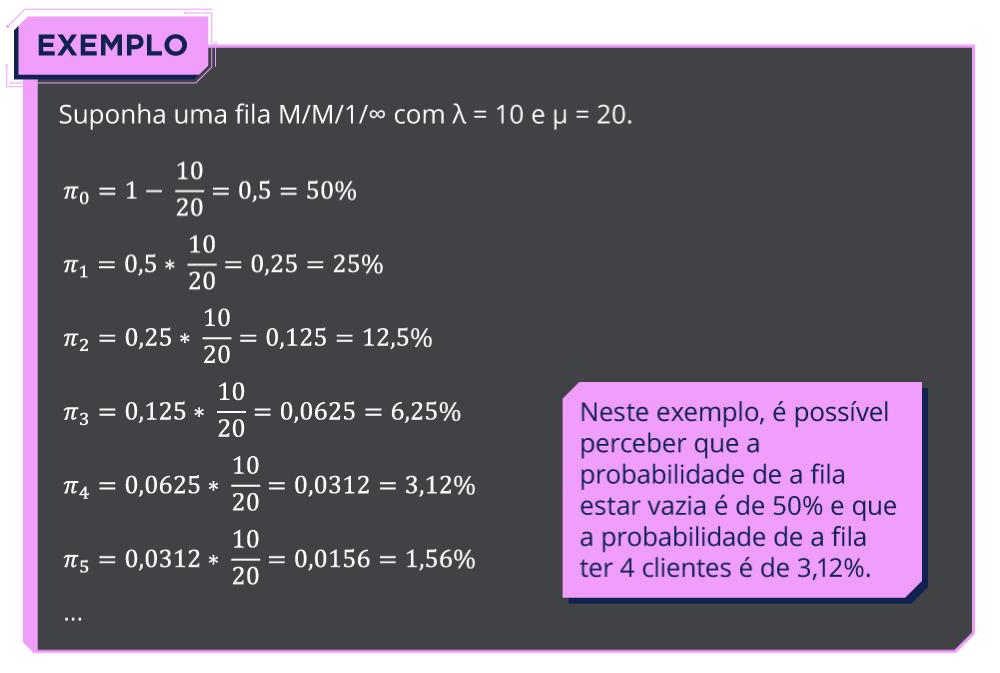
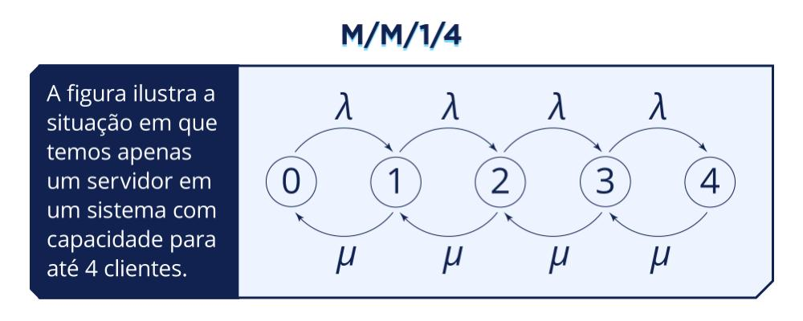
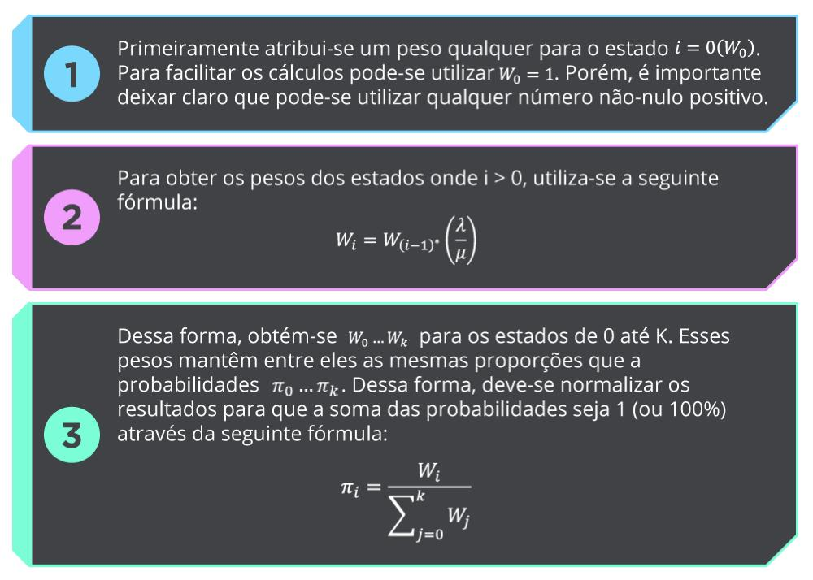
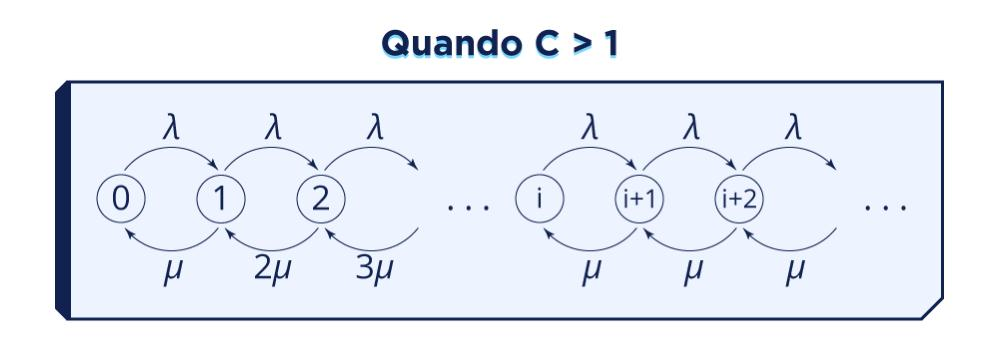
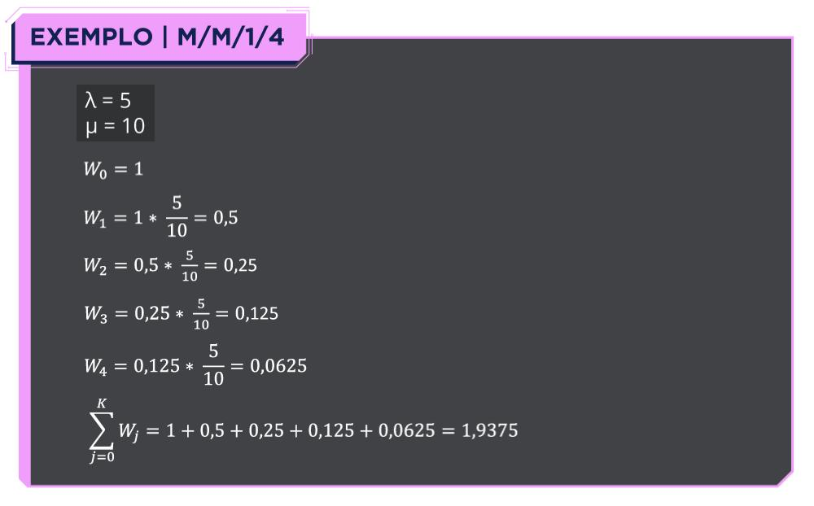
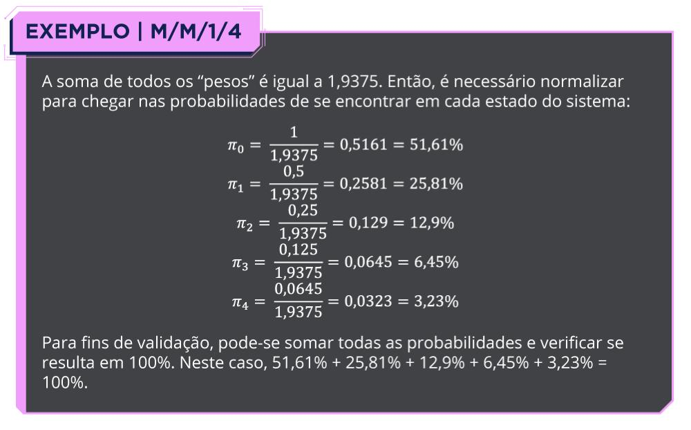
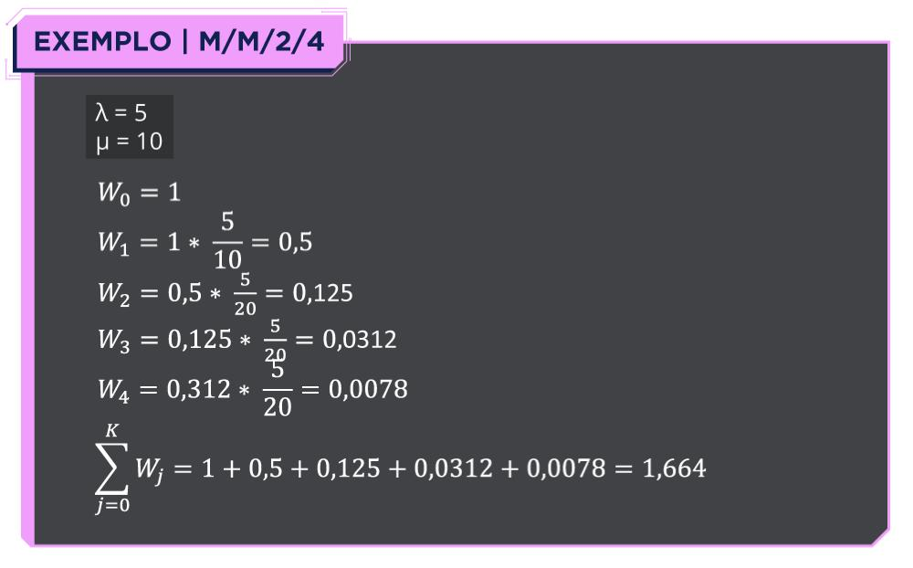
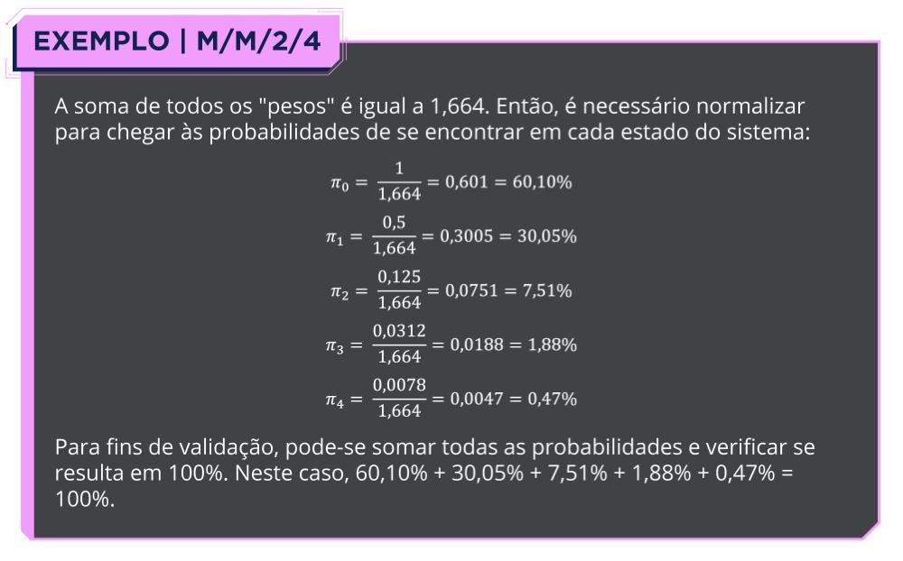

# M10 — Processo de Nascimento e Morte

Texto multimodal do Moodle (Prof. Rafael Chanin, Ph.D.), com as imagens salvas em [`imagens/`](imagens/) e o conteúdo delas transcrito logo abaixo de cada uma, para dar para buscar e copiar as fórmulas.

## Objetivos de aprendizagem

Compreender o conceito de "processo de nascimento e morte", um método analítico de avaliação de desempenho de sistemas baseado no formalismo de Cadeias de Markov (visto em detalhes no Módulo 12). O foco são as soluções para filas de capacidade finita e infinita: fundamentos teóricos, cálculo de medidas de desempenho e aplicação em problemas práticos (modelos M/M/1/∞ e M/M/C/K).

---

## Introdução

Nos módulos anteriores foi estudada a técnica de simulação para avaliação de desempenho de sistemas. A partir deste módulo começam os métodos analíticos. Métodos analíticos também se baseiam na modelagem de sistemas reais, mas com nível de abstração mais alto: usam relações matemáticas para criar modelos que representam sistemas reais. O conceito de processo de nascimento e morte segue Bolch et al. (1998).

Processo de nascimento e morte é um tipo específico de modelo markoviano: a representação de um sistema de uma fila simples através de estados e transições entre esses estados.

> **Modelo Markoviano** — é um modelo baseado nas características do formalismo de Cadeias de Markov, o qual será estudado mais detalhadamente ao longo desta disciplina.

O **nascimento** representa a chegada de mais um cliente na fila, e a **morte** representa um cliente que foi atendido. O tamanho da fila pode ser infinito ou finito. No processo de nascimento e morte **só existem transições entre estados vizinhos**: partindo do estado 3, por exemplo, só se pode ir para o estado 4 ou voltar para o estado 2.

> **Taxa de nascimento (λ):** representa a taxa em que ocorrem nascimentos em um dado estado.
> **Taxa de morte (μ):** representa a taxa em que ocorrem mortes em um dado estado.
>
> Diagrama: estados 0, 1, 2, …, i, i+1, i+2, … ligados por setas λ para a direita e μ para a esquerda.

Ou seja, λ (lambda) é a taxa de chegada de clientes na fila e μ (mu) é a taxa de serviço (atendimento) da fila.

> Imagine um caixa de supermercado com um atendente. Se chegam, em média, 10 clientes por hora nesse caixa, então λ = 10. Supondo que o atendente consegue atender, em média, 20 clientes por hora, então μ = 20. Neste exemplo, "nascem" clientes a uma taxa de 10 clientes por hora e "morrem" clientes a uma taxa de 20 clientes por hora.

### Taxa × tempo

Aqui se trabalha com **taxa** de chegada e **taxa** de atendimento. A taxa é o inverso do tempo. Se um caixa atende um cliente em 20 minutos (tempo), a taxa de atendimento por hora é 3: 20 minutos é 1/3 de hora, e o inverso de 1/3 é 3. Sempre prestar atenção na informação fornecida: se o enunciado der o tempo, é preciso transformar em taxa, respeitando a unidade de tempo.

- Vídeo do professor sobre tempo e taxa: <https://player.vimeo.com/video/920468220>

### Intensidade de tráfego

A relação entre a taxa de chegada λ e a taxa de atendimento μ é a **intensidade de tráfego**:

$$\rho = \frac{\lambda}{\mu}$$

- Se **ρ > 1**, há mais chegadas do que saídas de clientes. O número de clientes no sistema é ilimitado. Logo, o sistema é instável (a fila pode crescer para sempre).
- Se **ρ < 1**, há mais saídas do que chegadas de clientes. Existe uma solução estacionária para o sistema.
- Se **ρ = 1**, chegam e saem, em média, o mesmo número de clientes no sistema. Qualquer número de clientes no sistema é equiprovável. Logo, o sistema é instável.

Se um sistema é estável (tem solução estacionária), ele respeita a **hipótese da estacionariedade**.

- Vídeo do Prof. Afonso Sales sobre intensidade de tráfego e hipótese da estacionariedade: <https://www.youtube.com/watch?v=GTya0tFy3-g>

### Notação de Kendall

O texto apresenta duas formas de resolver processos de nascimento e morte:

1. sistema com capacidade infinita e um servidor (**M/M/1/∞**);
2. sistema com capacidade finita, podendo ter vários servidores (**M/M/C/K**).

> **Retomando o Módulo 3.** Sistemas de filas podem ser descritos com a Notação de Kendall, onde:
> - o primeiro parâmetro indica a distribuição de probabilidade do intervalo de chegadas de clientes;
> - o segundo parâmetro indica a distribuição de probabilidade do intervalo de atendimento de clientes;
> - o terceiro parâmetro indica o número de servidores da fila e o quarto parâmetro indica a capacidade da fila.

Tanto a chegada quanto o atendimento são exponenciais (M). Essa distribuição é "sem memória" (memoryless): eventos passados não influenciam o estado futuro. Uma fila que recebe, em média, 3 clientes por hora (exponencial) pode ficar horas sem clientes e depois receber dezenas de uma vez; o ponto é que, **na média**, ela recebe 3 clientes por hora.

---

## Filas M/M/1/∞ (ou M/M/1)

> Estados 0, 1, 2, … com λ em todas as transições para a direita e μ em todas as transições para a esquerda.

### Objeto interativo (dedução)

> Imagine uma fila de atendimento de um posto de saúde que possui apenas um médico (o servidor). Neste posto de saúde chegam pacientes a uma taxa λ e o médico atende os pacientes a uma taxa μ. Como essa fila é infinita, se a velocidade de atendimento do médico for inferior à velocidade de chegada de pacientes, essa fila (matematicamente) crescerá para sempre.

> Do ponto de vista da probabilidade de se encontrar em cada estado do sistema, a probabilidade de estar em um estado qualquer de **índice i** depende da probabilidade de estar no **estado i−1** e da **intensidade de tráfego ρ** da fila.
>
> Como o somatório de todas as probabilidades tem que ser 1 (ou 100%), a probabilidade do primeiro estado (estado 0 — ou seja, a probabilidade da fila estar vazia) é determinada sabendo-se a soma de todas as outras probabilidades.
>
> Logo, para i > 0, a probabilidade de se encontrar no estado i (πᵢ) é:
>
> $$\pi_i = \pi_{i-1} \cdot \left(\frac{\lambda}{\mu}\right)$$
>
> Ou de outra maneira:
>
> $$\pi_i = \pi_0 \cdot \left(\frac{\lambda}{\mu}\right)^i$$

> Agora falta encontrar π₀. Sabe-se que:
>
> $$\sum_{i \ge 0} \pi_i = 1 \quad\Rightarrow\quad \sum_{i \ge 0} \rho^i \cdot \pi_0 = 1$$
>
> Assim, a probabilidade de se encontrar no estado i = 0 é:
>
> $$\pi_0 = \frac{1}{\sum_{i \ge 0} \rho^i}$$
>
> Por uma sucessão de manipulações:
>
> $$\pi_0 = \frac{1}{\sum_{i \ge 0} \rho^i} = 1 - \rho = 1 - \frac{\lambda}{\mu}$$
>
> Este passo pode ser demonstrado da seguinte maneira. Deseja-se mostrar que:
>
> $$\frac{1}{\sum_{i \ge 0} \rho^i} = 1 - \rho$$

> Ou, invertendo-se: $\sum_{i \ge 0} \rho^i = \frac{1}{1-\rho}$. Seja $\pi_m = \sum_{i=0}^{m} \rho^i$ (soma parcial):
>
> $$\pi_{m+1} = \pi_m + \rho^{m+1} = \sum_{i=0}^{m+1} \rho^i$$
> $$\pi_m + \rho^{m+1} = 1 + \sum_{i=1}^{m+1} \rho^i = 1 + \sum_{i=0}^{m} \rho^{i+1} = 1 + \rho \cdot \sum_{i=0}^{m} \rho^i = 1 + \rho \cdot \pi_m$$
> $$\pi_m - \rho \cdot \pi_m = 1 - \rho^{m+1} \quad\Rightarrow\quad \pi_m = \frac{1 - \rho^{m+1}}{1 - \rho}$$
>
> Sejam m → ∞ e ρ < 1:
>
> $$\pi_\infty = \frac{1 - \rho^\infty}{1 - \rho} = \frac{1}{1 - \rho}$$
>
> Levando à primeira igualdade.
>
> *(Na imagem original, algumas linhas trazem pequenos erros de digitação — "1 + ρ^(m+1)" no lugar de "1 − ρ^(m+1)" e "1 − p" no denominador. A dedução acima está com os sinais corretos.)*

### Fórmulas M/M/1/∞

Probabilidade do sistema estar vazio (estado 0):

$$\pi_0 = 1 - \frac{\lambda}{\mu}$$

Probabilidade dos demais estados (1 em diante):

$$\pi_i = \pi_{(i-1)} \cdot \frac{\lambda}{\mu}$$

### Exemplo M/M/1/∞

> Suponha uma fila M/M/1/∞ com λ = 10 e μ = 20.
>
> | Estado | Cálculo | Probabilidade |
> |---|---|---|
> | π₀ | 1 − 10/20 | 0,5 = 50% |
> | π₁ | 0,5 · 10/20 | 0,25 = 25% |
> | π₂ | 0,25 · 10/20 | 0,125 = 12,5% |
> | π₃ | 0,125 · 10/20 | 0,0625 = 6,25% |
> | π₄ | 0,0625 · 10/20 | 0,0312 = 3,12% |
> | π₅ | 0,0312 · 10/20 | 0,0156 = 1,56% |
> | … | | |
>
> Neste exemplo, a probabilidade de a fila estar vazia é de 50% e a probabilidade de a fila ter 4 clientes é de 3,12%.

- Vídeo: diferença entre probabilidade de um estado e probabilidade acumulada: <https://player.vimeo.com/video/939613205>
- Vídeo do Prof. Afonso Sales resolvendo um exemplo prático M/M/1/∞: <https://youtu.be/Cx-yWDUT7RQ>

---

## Filas M/M/C/K

Dois casos: um servidor (M/M/1/K) e mais de um servidor (C > 1). A figura abaixo mostra um servidor num sistema com capacidade para até 4 clientes.

> **M/M/1/4** — estados 0, 1, 2, 3, 4 (o último estado é K = 4), com λ para a direita e μ para a esquerda.

### Método dos pesos

1. Atribui-se um peso qualquer para o estado i = 0 (W₀). Para facilitar os cálculos pode-se usar **W₀ = 1**, mas qualquer número não-nulo positivo serve.
2. Para obter os pesos dos estados onde i > 0:
   $$W_i = W_{(i-1)} \cdot \left(\frac{\lambda}{\mu}\right)$$
3. Assim obtém-se W₀ … W_K para os estados de 0 até K. Esses pesos mantêm entre si as mesmas proporções que as probabilidades π₀ … π_K, então é preciso normalizar para que a soma das probabilidades seja 1 (100%):
   $$\pi_i = \frac{W_i}{\sum_{j=0}^{K} W_j}$$

### Quando C > 1

> Diagrama: λ em todas as transições para a direita; para a esquerda, μ, 2μ, 3μ, … — a taxa de saída cresce com o número de clientes até chegar ao número de servidores C.

Depois de atribuir um peso ao estado 0 (por exemplo, W₀ = 1), os pesos dos demais estados são:

$$W_i = W_{(i-1)} \cdot \left(\frac{\lambda}{\min(i, C) \cdot \mu}\right)$$

onde min(x, y) = x se x < y, ou min(x, y) = y caso contrário.

Intuição: uma fila única de banco com vários atendentes. Quanto mais atendentes, mais rápido o atendimento do sistema. Mas se o banco tem 3 atendentes e só há duas pessoas, um atendente fica ocioso e a velocidade máxima de atendimento naquele momento é 2μ.

### Exemplo M/M/1/4

> λ = 5, μ = 10
>
> | Peso | Cálculo | Valor |
> |---|---|---|
> | W₀ | — | 1 |
> | W₁ | 1 · 5/10 | 0,5 |
> | W₂ | 0,5 · 5/10 | 0,25 |
> | W₃ | 0,25 · 5/10 | 0,125 |
> | W₄ | 0,125 · 5/10 | 0,0625 |
>
> $$\sum_{j=0}^{K} W_j = 1 + 0{,}5 + 0{,}25 + 0{,}125 + 0{,}0625 = 1{,}9375$$

> A soma de todos os "pesos" é igual a 1,9375. Então é necessário normalizar para chegar nas probabilidades de se encontrar em cada estado do sistema:
>
> | Estado | Cálculo | Probabilidade |
> |---|---|---|
> | π₀ | 1 / 1,9375 | 0,5161 = 51,61% |
> | π₁ | 0,5 / 1,9375 | 0,2581 = 25,81% |
> | π₂ | 0,25 / 1,9375 | 0,129 = 12,9% |
> | π₃ | 0,125 / 1,9375 | 0,0645 = 6,45% |
> | π₄ | 0,0625 / 1,9375 | 0,0323 = 3,23% |
>
> Para validar, soma-se todas as probabilidades e verifica-se se resulta em 100%: 51,61% + 25,81% + 12,9% + 6,45% + 3,23% = 100%.
>
> *(A imagem original escreve "0,0645 / 1,9375" na linha de π₄; o peso correto é W₄ = 0,0625, e o resultado 3,23% bate com ele.)*

### Exemplo M/M/2/4

Mesma capacidade (4 clientes), mas com dois servidores. A partir do segundo estado, a taxa de atendimento é multiplicada por 2, porque há dois servidores atendendo.

> λ = 5, μ = 10
>
> | Peso | Cálculo | Valor |
> |---|---|---|
> | W₀ | — | 1 |
> | W₁ | 1 · 5/10 | 0,5 |
> | W₂ | 0,5 · 5/20 | 0,125 |
> | W₃ | 0,125 · 5/20 | 0,0312 |
> | W₄ | 0,0312 · 5/20 | 0,0078 |
>
> $$\sum_{j=0}^{K} W_j = 1 + 0{,}5 + 0{,}125 + 0{,}0312 + 0{,}0078 = 1{,}664$$
>
> *(A imagem original escreve "0,312" na linha de W₄; o valor correto é 0,0312.)*

> A soma de todos os "pesos" é igual a 1,664. Normalizando:
>
> | Estado | Cálculo | Probabilidade |
> |---|---|---|
> | π₀ | 1 / 1,664 | 0,601 = 60,10% |
> | π₁ | 0,5 / 1,664 | 0,3005 = 30,05% |
> | π₂ | 0,125 / 1,664 | 0,0751 = 7,51% |
> | π₃ | 0,0312 / 1,664 | 0,0188 = 1,88% |
> | π₄ | 0,0078 / 1,664 | 0,0047 = 0,47% |
>
> Validação: 60,10% + 30,05% + 7,51% + 1,88% + 0,47% = 100%.

- Vídeo do Prof. Afonso Sales resolvendo passo a passo o M/M/1/4 e reforçando a solução de M/M/C/K: <https://youtu.be/uqNX30lHQgM>

---

## Referência

BOLCH, G. et al. *Queueing Networks and Markov Chains: Modeling and Performance Evaluation with Computer Science Applications*. New York: John Wiley & Sons, 1998.
