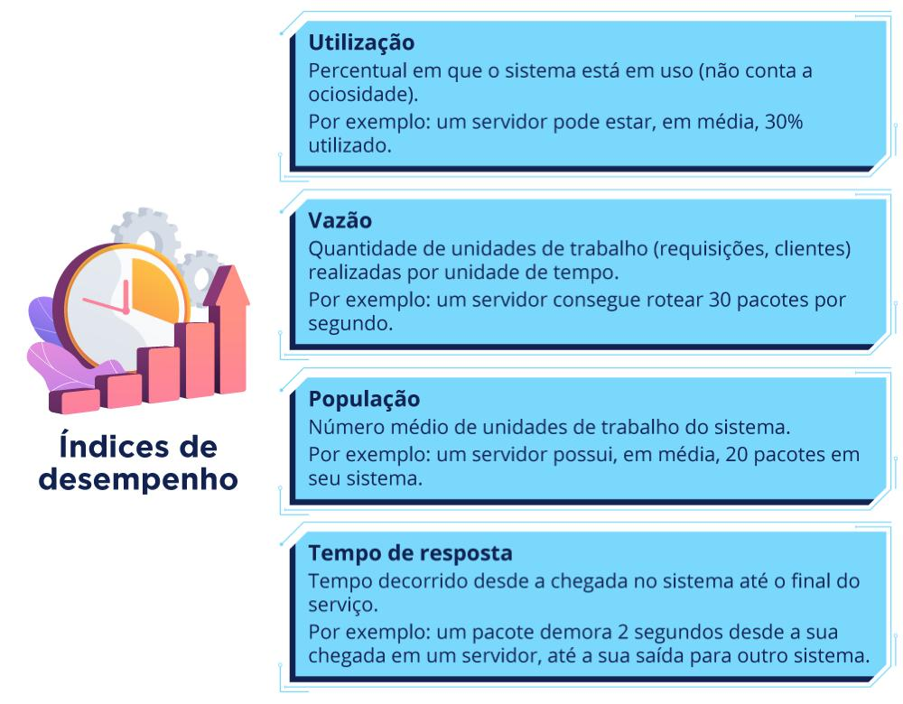
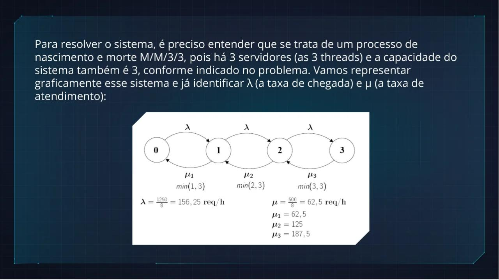
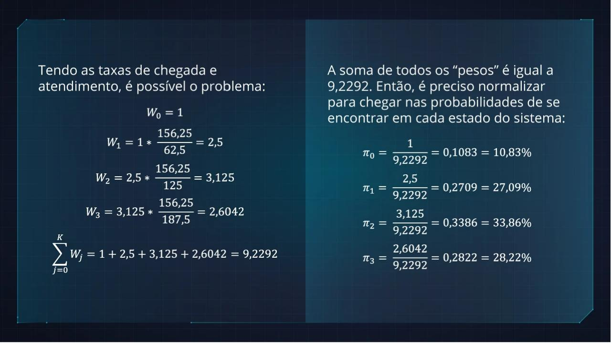
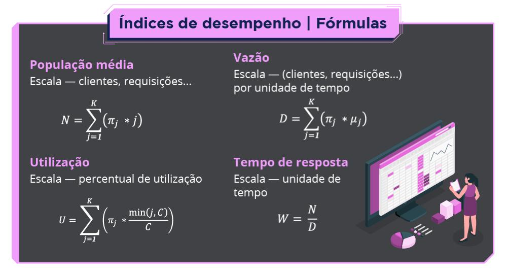
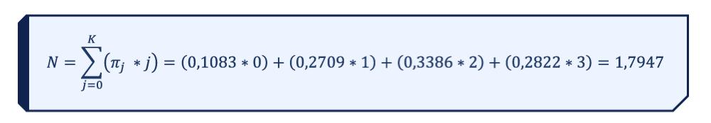
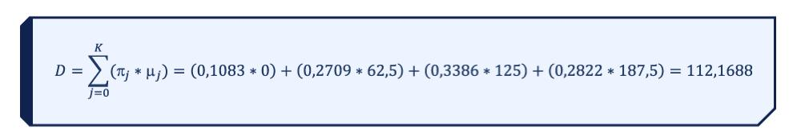
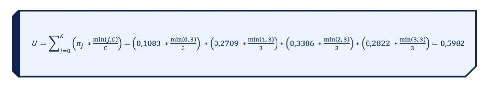

# M11 — Cálculo dos Índices de Desempenho

Texto multimodal do Moodle (Prof. Rafael Chanin, Ph.D.), com as imagens salvas em [`imagens/`](imagens/) e o conteúdo delas transcrito logo abaixo de cada uma.

## Objetivos de aprendizagem

Entender e aplicar os índices de desempenho (utilização, vazão, população e tempo de resposta) em processos de nascimento e morte. Esses índices ajudam a extrair informações para a tomada de decisão na avaliação de desempenho de sistemas: identificar gargalos, otimizar recursos e melhorar a experiência dos usuários. Por exemplo, se o tempo de resposta de um sistema está alto (e por isso clientes estão sendo perdidos), dá para agir rápido para mitigar o problema.

---

## Os índices

No M10 foi visto como modelar e resolver processos de nascimento e morte e como calcular a probabilidade de o sistema estar em cada estado. A partir dessas probabilidades dá para inferir a **perda de clientes** da fila e os índices de desempenho: **utilização**, **vazão**, **população** e **tempo de resposta**.

> - **Utilização** — percentual em que o sistema está em uso (não conta a ociosidade). Ex.: um servidor pode estar, em média, 30% utilizado.
> - **Vazão** — quantidade de unidades de trabalho (requisições, clientes) realizadas por unidade de tempo. Ex.: um servidor consegue rotear 30 pacotes por segundo.
> - **População** — número médio de unidades de trabalho do sistema. Ex.: um servidor possui, em média, 20 pacotes em seu sistema.
> - **Tempo de resposta** — tempo decorrido desde a chegada no sistema até o final do serviço. Ex.: um pacote demora 2 segundos desde a sua chegada em um servidor até a sua saída para outro sistema.

---

## Exemplo prático (objeto interativo)

> Suponha um servidor que recebe em média **1250 requisições por dia** de acesso. Esse servidor está disponível para o público em **dois turnos de 4 horas**. O servidor utiliza **três threads** para processar as requisições e a sua implementação disponibilizou **apenas esses três espaços de armazenamento**. O sistema consegue processar **250 requisições por turno**, em média. Quando uma requisição chega no servidor e encontra todos os espaços ocupados, ela é perdida.
>
> Acompanhe o cálculo das perdas por dia desse sistema, bem como a sua utilização, vazão, população média e o seu tempo de resposta.

> Para resolver o sistema, é preciso entender que se trata de um processo de nascimento e morte **M/M/3/3**, pois há 3 servidores (as 3 threads) e a capacidade do sistema também é 3. Representando graficamente o sistema e identificando λ (taxa de chegada) e μ (taxa de atendimento):
>
> Estados 0, 1, 2, 3; λ em todas as transições para a direita; para a esquerda μ₁ = min(1,3)·μ, μ₂ = min(2,3)·μ, μ₃ = min(3,3)·μ.
>
> $$\lambda = \frac{1250}{8} = 156{,}25 \text{ req/h} \qquad \mu = \frac{500}{8} = 62{,}5 \text{ req/h}$$
> $$\mu_1 = 62{,}5 \qquad \mu_2 = 125 \qquad \mu_3 = 187{,}5$$

> Note que neste exemplo as taxas foram trabalhadas **por hora**; dá para trabalhar por minutos, segundos, dias ou qualquer outra unidade, desde que a taxa de chegada e a taxa de atendimento estejam **na mesma unidade**.
>
> Por exemplo, com taxas por dia teríamos λ = 1250, μ₁ = 500, μ₂ = 1000 e μ₃ = 1500. Há 3 taxas de atendimento justamente porque há 3 servidores.

> Tendo as taxas de chegada e atendimento, é possível resolver o problema:
>
> | Peso | Cálculo | Valor |
> |---|---|---|
> | W₀ | — | 1 |
> | W₁ | 1 · 156,25 / 62,5 | 2,5 |
> | W₂ | 2,5 · 156,25 / 125 | 3,125 |
> | W₃ | 3,125 · 156,25 / 187,5 | 2,6042 |
>
> $$\sum_{j=0}^{K} W_j = 1 + 2{,}5 + 3{,}125 + 2{,}6042 = 9{,}2292$$
>
> A soma de todos os "pesos" é 9,2292. Normalizando:
>
> | Estado | Cálculo | Probabilidade |
> |---|---|---|
> | π₀ | 1 / 9,2292 | 0,1083 = 10,83% |
> | π₁ | 2,5 / 9,2292 | 0,2709 = 27,09% |
> | π₂ | 3,125 / 9,2292 | 0,3386 = 33,86% |
> | π₃ | 2,6042 / 9,2292 | 0,2822 = 28,22% |

Todo esse processo foi visto no M10. Com a probabilidade de cada um dos 4 estados, dá para calcular a perda média de clientes e os índices de desempenho.

---

## Perda de clientes

A perda ocorre quando o sistema está cheio e um novo cliente tenta entrar. Se o sistema está vazio, com um ou com dois clientes, sempre há espaço; com três clientes não há como entrar mais ninguém.

A probabilidade do sistema estar no estado 3 é 28,22%, que é a probabilidade de perder clientes. A perda é a taxa de chegada multiplicada por essa probabilidade. A taxa de chegada por dia é 1250:

$$\text{Perda} = \lambda \cdot \pi_K = 0{,}2822 \cdot 1250 = 353{,}75$$

O sistema perde, em média, **353 clientes por dia**. Já dá para ver que ele não tem capacidade para atender todos os clientes: quase 1/3 dos clientes que chegam são perdidos.

- Vídeo do Prof. Afonso Sales explicando o exemplo passo a passo: <https://youtu.be/53QqtVX_UFw>

---

## Fórmulas dos índices de desempenho

| Índice | Escala | Fórmula |
|---|---|---|
| População média (N) | clientes, requisições… | $N = \sum_{j=1}^{K} (\pi_j \cdot j)$ |
| Vazão (D) | (clientes, requisições…) por unidade de tempo | $D = \sum_{j=1}^{K} (\pi_j \cdot \mu_j)$ |
| Utilização (U) | percentual de utilização | $U = \sum_{j=1}^{K} \left(\pi_j \cdot \frac{\min(j, C)}{C}\right)$ |
| Tempo de resposta (W) | unidade de tempo | $W = \frac{N}{D}$ |

μⱼ é a taxa de atendimento no estado j, ou seja, min(j, C) · μ. Os somatórios podem começar em j = 0 ou j = 1: o termo de j = 0 é sempre zero.

- Vídeo do Prof. Afonso Sales explicando as fórmulas: <https://youtu.be/xXMoGpyT21M>

### População média (N)

$$N = \sum_{j=0}^{K} (\pi_j \cdot j) = (0{,}1083 \cdot 0) + (0{,}2709 \cdot 1) + (0{,}3386 \cdot 2) + (0{,}2822 \cdot 3) = 1{,}7947$$

A população média é **1,7947 requisições**: em média, esse é o número de requisições no sistema em um dado momento. É um resultado matemático; as requisições não são fracionadas, e a qualquer momento o sistema terá 0, 1, 2 ou 3 requisições.

### Vazão (D)

$$D = \sum_{j=0}^{K} (\pi_j \cdot \mu_j) = (0{,}1083 \cdot 0) + (0{,}2709 \cdot 62{,}5) + (0{,}3386 \cdot 125) + (0{,}2822 \cdot 187{,}5) = 112{,}1688$$

A vazão é **112,1688 requisições por hora**, em média: é a velocidade de atendimento do sistema.

O servidor funciona em dois turnos de 4 horas (8 horas por dia). 112,1688 × 8 ≈ **897 requisições por dia** atendidas. Como chegam 1250 por dia, o sistema deixa de atender 1250 − 897 = **353**, que são exatamente as perdas calculadas antes.

### Utilização (U)

$$U = \sum_{j=0}^{K} \left(\pi_j \cdot \frac{\min(j, C)}{C}\right) = \left(0{,}1083 \cdot \tfrac{\min(0,3)}{3}\right) + \left(0{,}2709 \cdot \tfrac{\min(1,3)}{3}\right) + \left(0{,}3386 \cdot \tfrac{\min(2,3)}{3}\right) + \left(0{,}2822 \cdot \tfrac{\min(3,3)}{3}\right) = 0{,}5982$$

*(Na imagem original os termos aparecem ligados por "∗"; o certo é soma, "+", e o resultado 0,5982 bate com a soma.)*

A utilização é **59,82%**. Como há 3 servidores, em vários momentos alguns deles estão ociosos. **Quando o sistema tem apenas 1 servidor, a utilização é a probabilidade de o sistema não estar vazio** (1 − π₀).

### Tempo de resposta (W)

$$W = \frac{N}{D} = \frac{1{,}7947}{112{,}1688} = 0{,}016 \text{ h}$$

Em média, uma requisição que chega nesse sistema demora **0,016 horas** (≈ 0,96 min) para ser atendida. Neste exemplo, 0,016 h é sempre o tempo de resposta, porque há 3 servidores e só 3 espaços (ninguém espera em fila).

Já numa fila de supermercado com um único atendente, o tempo de resposta varia com o tamanho da fila (com 10 pessoas na frente, o tempo tende a ser maior do que com 4). O supermercado poderia informar o tempo médio de resposta de cada fila para os clientes decidirem em qual entrar.

---

## Referência

BOLCH, G. et al. *Queueing Networks and Markov Chains: Modeling and Performance Evaluation with Computer Science Applications*. New York: John Wiley & Sons, 1998.
