# M12 — Cadeias de Markov

Texto multimodal do Moodle (Prof. Rafael Chanin, Ph.D.), com as imagens salvas em [`imagens/`](imagens/) e o conteúdo delas transcrito logo abaixo de cada uma, para dar para buscar e copiar as fórmulas.

## Objetivos de aprendizagem

Compreender o conceito de "Cadeias de Markov", modelo matemático usado em estatística, ciência da computação, engenharia e economia. Explorar como as Cadeias de Markov representam sistemas estocásticos que evoluem ao longo do tempo, com base na probabilidade de transição entre estados, e aplicar a teoria para analisar e modelar problemas reais que envolvem transições e aleatoriedade.

- Vídeo de abertura do professor Rafael Chanin: <https://player.vimeo.com/video/889211440>

---

## Contextualização

As Cadeias de Markov, nomeadas em homenagem ao matemático russo Andrei Markov, são modelos para sistemas dinâmicos que evoluem ao longo do tempo. São usadas para prever eventos futuros a partir do estado presente.

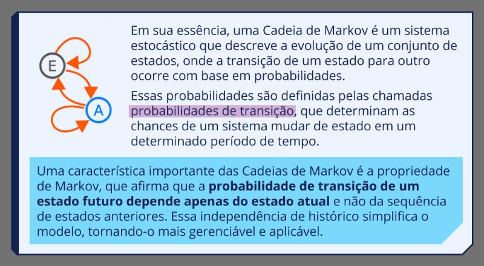

> Em sua essência, uma Cadeia de Markov é um sistema estocástico que descreve a evolução de um conjunto de estados, onde a transição de um estado para outro ocorre com base em probabilidades.
>
> Essas probabilidades são definidas pelas chamadas **probabilidades de transição**, que determinam as chances de um sistema mudar de estado em um determinado período de tempo.
>
> Uma característica importante das Cadeias de Markov é a **propriedade de Markov**: a **probabilidade de transição de um estado futuro depende apenas do estado atual** e não da sequência de estados anteriores. Essa independência de histórico simplifica o modelo.
>
> Diagrama: dois estados, E e A, com setas indo de um para o outro e laços voltando para o próprio estado.

> **Cadeias de Markov | Usos:** previsão do tempo; análise de séries temporais financeiras; inteligência artificial (reconhecimento de padrões); sistemas de fila; análise de tráfego de rede; modelagem de processos bioquímicos.

A aplicação mais conhecida talvez seja o Google: os criadores enxergaram a Internet como uma grande Cadeia de Markov, em que os estados são os sites e as transições são os links de um site para outro. Assim deu para "calcular" quais sites são os mais relevantes para cada busca.

---

## Do processo de nascimento e morte à Cadeia de Markov

Nos módulos 10 e 11 foi visto o processo de nascimento e morte, um tipo específico de modelo markoviano que tem fórmulas prontas para as probabilidades. Para os demais modelos é preciso montar e resolver um sistema de equações. Com esse método dá para resolver praticamente qualquer modelo.

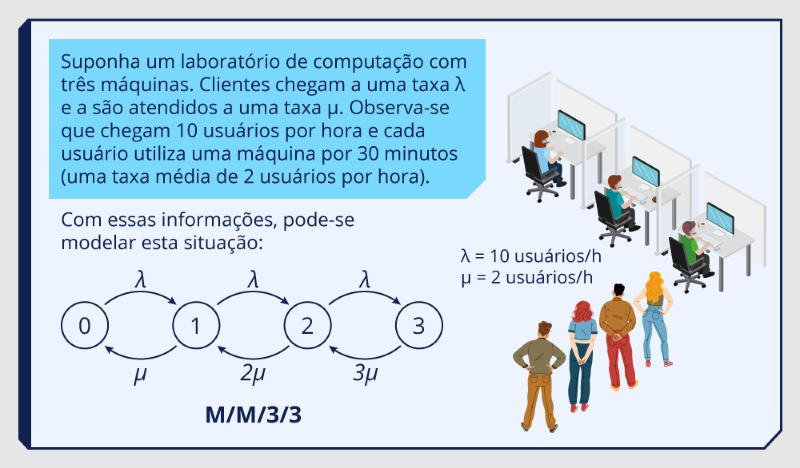

> Suponha um laboratório de computação com três máquinas. Clientes chegam a uma taxa λ e são atendidos a uma taxa μ. Chegam 10 usuários por hora e cada usuário usa uma máquina por 30 minutos (taxa média de 2 usuários por hora).
>
> λ = 10 usuários/h, μ = 2 usuários/h
>
> Diagrama: estados 0, 1, 2, 3; setas λ para a direita (0→1, 1→2, 2→3) e μ, 2μ, 3μ para a esquerda (1→0, 2→1, 3→2). Modelo **M/M/3/3**.

Esse modelo ainda é um processo de nascimento e morte e dá para resolver com o M10. Agora suponha que se queira representar a **falta de luz** nesse laboratório:

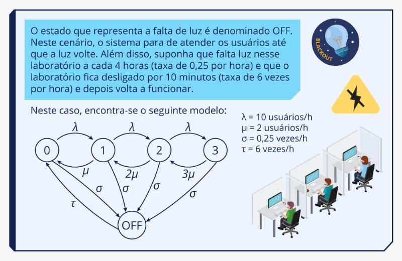

> O estado que representa a falta de luz é chamado **OFF**. Nesse cenário o sistema para de atender os usuários até a luz voltar. Falta luz a cada 4 horas (taxa de 0,25 por hora) e o laboratório fica desligado por 10 minutos (taxa de 6 vezes por hora), e depois volta a funcionar.
>
> λ = 10 usuários/h, μ = 2 usuários/h, σ = 0,25 vezes/h, τ = 6 vezes/h
>
> Diagrama: os mesmos estados 0 a 3 com λ e μ, 2μ, 3μ; além disso, cada estado 0, 1, 2, 3 tem uma seta σ indo para OFF, e OFF tem uma seta τ voltando para o estado 0.

Agora não é mais um processo de nascimento e morte (há transições entre estados que não são vizinhos): é uma **Cadeia de Markov**.

---

## O formalismo

O formalismo de Cadeias de Markov descreve o funcionamento de um sistema com um conjunto de **estados** e **transições** entre esses estados. As transições são modeladas por um processo estocástico de tempo contínuo ou discreto, definidos por distribuições **exponenciais** ou **geométricas**, respectivamente.

O modelo pode ser visto como uma máquina de estados: os nodos são os estados e os arcos são as transições. Ele é classificado pela escala de tempo:

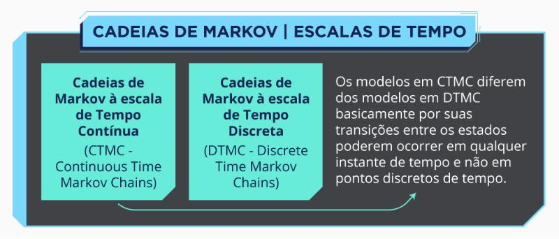

> **Cadeias de Markov | Escalas de tempo**
>
> - Cadeias de Markov à escala de tempo **contínua** (CTMC — Continuous Time Markov Chains)
> - Cadeias de Markov à escala de tempo **discreta** (DTMC — Discrete Time Markov Chains)
>
> Os modelos em CTMC diferem dos modelos em DTMC basicamente porque suas transições podem ocorrer em qualquer instante de tempo, e não em pontos discretos de tempo.

Propriedades:

- os estados são discretos e enumeráveis (o formalismo permite cadeias de infinitos estados);
- a transição depende **só do estado atual**, não importa quais foram os estados anteriores;
- a transição obedece a uma distribuição exponencial (CTMC, usa **taxa**) ou geométrica (DTMC, usa **probabilidade**).

A representação gráfica é um autômato: cada estado do autômato é um estado do modelo e cada transição recebe uma taxa (CTMC) ou uma probabilidade (DTMC).

Matematicamente, o modelo é uma **matriz de transição de estados**. A probabilidade de cada estado em regime estacionário (a solução do modelo) é a solução do sistema linear:

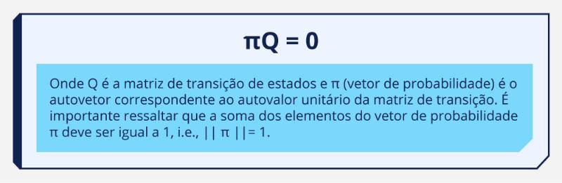

$$\pi Q = 0$$

> Onde Q é a matriz de transição de estados e π (vetor de probabilidade) é o autovetor correspondente ao autovalor unitário da matriz de transição. A soma dos elementos do vetor de probabilidade π deve ser igual a 1, i.e., ‖π‖ = 1.

- **CTMC:** a matriz Q se chama **gerador infinitesimal**. Cada elemento fora da diagonal (linha i, coluna j) é a **taxa** de transição do estado i para o estado j. Os elementos da diagonal principal são o ajuste para que **a soma de cada linha seja zero**.
- **DTMC:** a matriz P se chama **matriz estocástica**. Cada elemento fora da diagonal é a **probabilidade** de transição. A diagonal é o ajuste para que **a soma de cada linha seja um**.

O foco do módulo é **CTMC** (taxas de ocorrência).

---

## Exemplo: laboratório com falta de luz

### Passo 1 — matriz de transição de estados

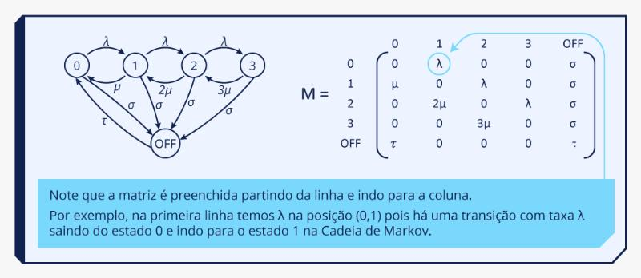

|     | 0  | 1  | 2  | 3  | OFF |
|-----|----|----|----|----|-----|
| **0**   | 0  | λ  | 0  | 0  | σ |
| **1**   | μ  | 0  | λ  | 0  | σ |
| **2**   | 0  | 2μ | 0  | λ  | σ |
| **3**   | 0  | 0  | 3μ | 0  | σ |
| **OFF** | τ  | 0  | 0  | 0  | τ* |

> A matriz é preenchida **partindo da linha e indo para a coluna**. Por exemplo, na primeira linha há λ na posição (0,1) porque há uma transição com taxa λ saindo do estado 0 e indo para o estado 1.

\* Na imagem do Moodle a posição (OFF, OFF) aparece com τ, mas não existe transição de OFF para OFF; o valor que faz sentido ali é 0 (e no gerador do passo 2 ela vira −τ).

### Passo 2 — gerador infinitesimal

Troca cada número da diagonal principal pelo valor que faz a soma da linha dar zero (o negativo da soma das taxas que saem daquele estado):

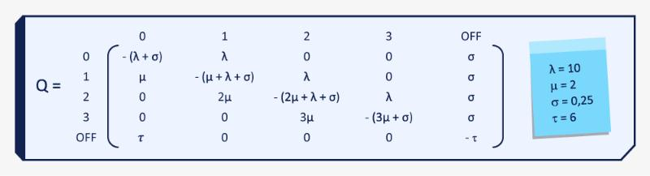

|     | 0 | 1 | 2 | 3 | OFF |
|-----|---|---|---|---|-----|
| **0**   | −(λ + σ) | λ | 0 | 0 | σ |
| **1**   | μ | −(μ + λ + σ) | λ | 0 | σ |
| **2**   | 0 | 2μ | −(2μ + λ + σ) | λ | σ |
| **3**   | 0 | 0 | 3μ | −(3μ + σ) | σ |
| **OFF** | τ | 0 | 0 | 0 | −τ |

Substituindo as taxas (λ = 10, μ = 2, σ = 0,25, τ = 6):

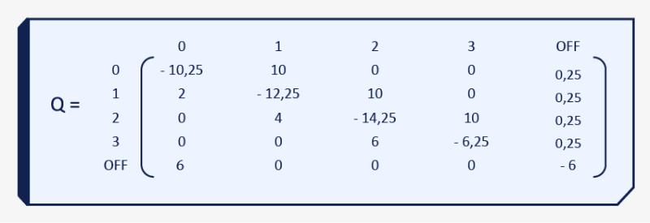

|     | 0 | 1 | 2 | 3 | OFF |
|-----|---|---|---|---|-----|
| **0**   | −10,25 | 10 | 0 | 0 | 0,25 |
| **1**   | 2 | −12,25 | 10 | 0 | 0,25 |
| **2**   | 0 | 4 | −14,25 | 10 | 0,25 |
| **3**   | 0 | 0 | 6 | −6,25 | 0,25 |
| **OFF** | 6 | 0 | 0 | 0 | −6 |

### Passo 3 — multiplicar o vetor pela matriz e igualar a zero

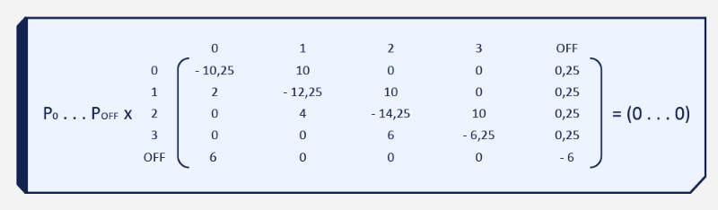

$$(P_0 \; P_1 \; P_2 \; P_3 \; P_{OFF}) \times Q = (0 \; 0 \; 0 \; 0 \; 0)$$

Cada equação sai de **uma coluna** da matriz: multiplica cada P pelo número daquela coluna na linha do estado e soma.

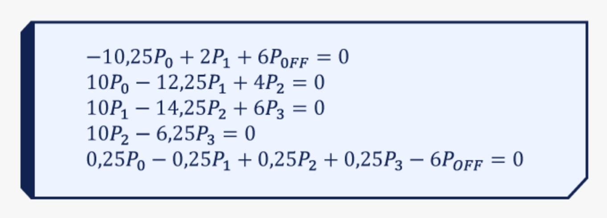

$$
\begin{aligned}
-10{,}25P_0 + 2P_1 + 6P_{OFF} &= 0 && \text{(coluna 0)}\\
10P_0 - 12{,}25P_1 + 4P_2 &= 0 && \text{(coluna 1)}\\
10P_1 - 14{,}25P_2 + 6P_3 &= 0 && \text{(coluna 2)}\\
10P_2 - 6{,}25P_3 &= 0 && \text{(coluna 3)}\\
0{,}25P_0 + 0{,}25P_1 + 0{,}25P_2 + 0{,}25P_3 - 6P_{OFF} &= 0 && \text{(coluna OFF)}
\end{aligned}
$$

Na imagem do Moodle a última equação aparece com "− 0,25P₁", mas pela coluna OFF da matriz o sinal é **+** (todos os estados vão para OFF com a mesma taxa σ). Os valores do exemplo fecham com o sinal +.

### Passo 4 — resolver o sistema

Qualquer método de resolução de sistemas serve. Na disciplina se atribui um **valor arbitrário (positivo, não nulo)** a uma das variáveis e, a partir dele, se encontram as demais.

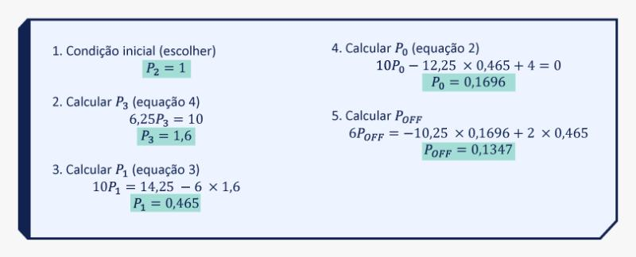

1. Condição inicial (escolher): **P₂ = 1**
2. Calcular P₃ (equação 4): 6,25 P₃ = 10 → **P₃ = 1,6**
3. Calcular P₁ (equação 3): 10 P₁ = 14,25 − 6 × 1,6 → **P₁ = 0,465**
4. Calcular P₀ (equação 2): 10 P₀ − 12,25 × 0,465 + 4 = 0 → **P₀ = 0,1696**
5. Calcular P_OFF (equação 1): 6 P_OFF = −10,25 × 0,1696 + 2 × 0,465 → **P_OFF = 0,1347**

(Na imagem a equação 5 do passo aparece sem o sinal trocado; isolando P_OFF na equação 1 fica 6 P_OFF = 10,25 × 0,1696 − 2 × 0,465 = 0,8084, o que dá o mesmo 0,1347.)

Sobrou uma equação sem usar (a da coluna OFF): ela serve de **conferência**. 0,25 × (0,1696 + 0,465 + 1 + 1,6) = 0,8087 ≈ 6 × 0,1347 = 0,8082.

Escolher outro valor, ou outra variável, não muda nada: no fim as proporções são as mesmas. Por exemplo, com P₂ = 2 sai P₃ = 3,2, P₁ = 0,93 e assim por diante.

### Passo 5 — normalizar

Somar todos os valores encontrados e dividir cada um pelo total:

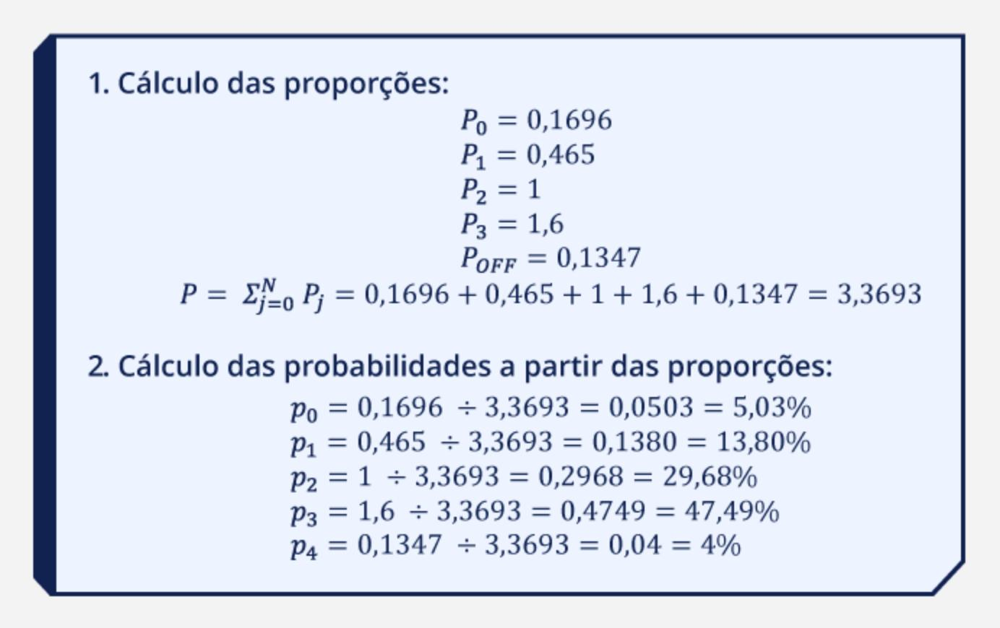

1. Proporções: P₀ = 0,1696; P₁ = 0,465; P₂ = 1; P₃ = 1,6; P_OFF = 0,1347

   P = Σ Pⱼ = 0,1696 + 0,465 + 1 + 1,6 + 0,1347 = **3,3693**

2. Probabilidades:

| Estado | Conta | Probabilidade |
|---|---|---|
| 0 | 0,1696 ÷ 3,3693 | 0,0503 = 5,03% |
| 1 | 0,465 ÷ 3,3693 | 0,1380 = 13,80% |
| 2 | 1 ÷ 3,3693 | 0,2968 = 29,68% |
| 3 | 1,6 ÷ 3,3693 | 0,4749 = 47,49% |
| OFF | 0,1347 ÷ 3,3693 | 0,04 = 4% |

O laboratório tem 5,03% de chance de estar vazio, 13,80% de ter um usuário, 29,68% de ter dois, 47,49% de ter três e 4% de estar sem luz.

- Vídeo do Prof. Afonso Sales resolvendo o exemplo do laboratório: <https://youtu.be/Gx1nHj4XoOc>

---

## Referência

STEWART, William J. *Introduction to the numerical solution of Markov Chains*. Princeton: Princeton University Press, 1994.
