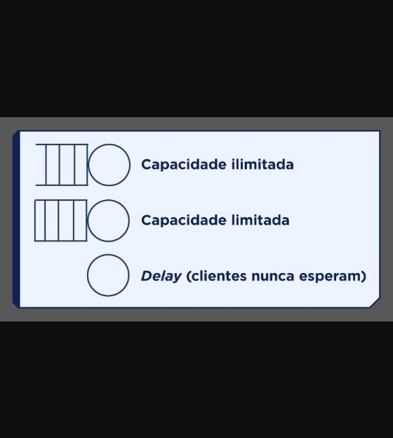
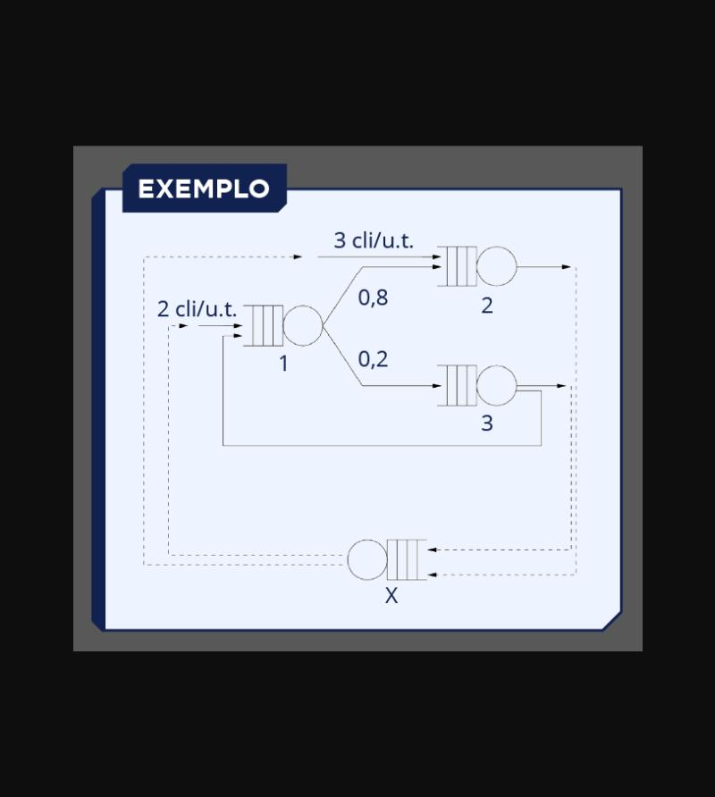
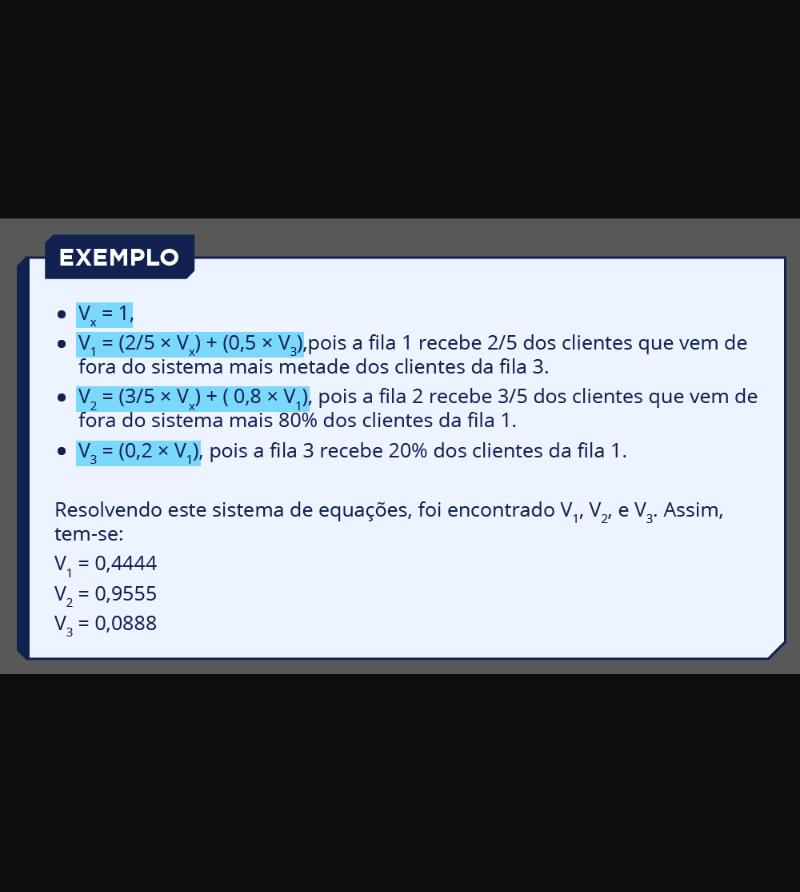
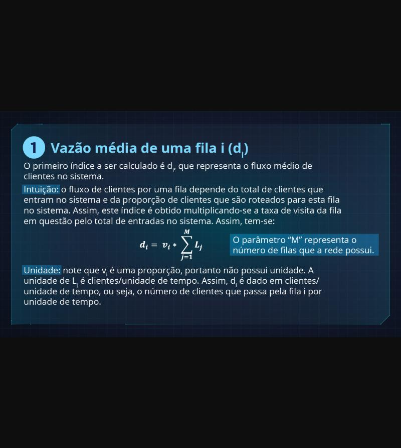
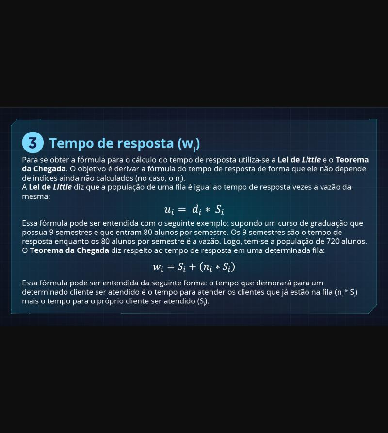
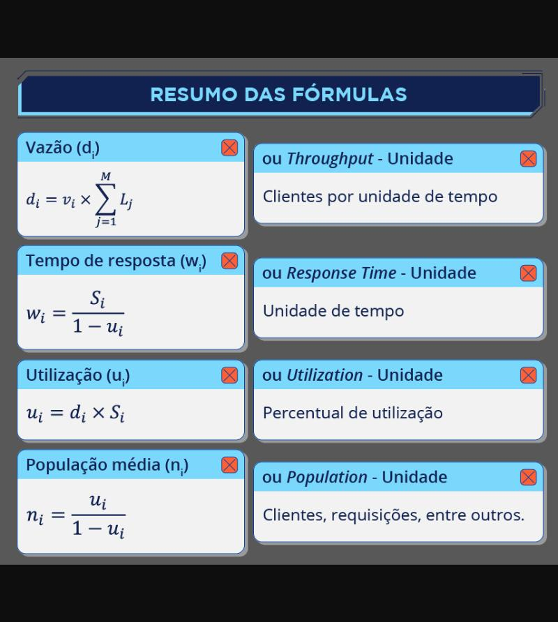

# M13 — Redes (abertas) de filas de espera

Texto multimodal do Moodle (Prof. Rafael Chanin, Ph.D.), com as imagens salvas em [`imagens/`](imagens/) e o conteúdo delas transcrito logo abaixo de cada uma.

## Objetivos de aprendizagem

Formalismo das redes de filas de espera abertas no contexto matemático (modelo analítico), indo além dos processos de nascimento e morte.

---

## Sistemas e redes de filas

Qualquer sistema com chegada de requisições para um ou mais servidores é um sistema de filas. O comprimento das filas depende da taxa média de chegada e das flutuações dessa taxa: mesmo com chegada menor que atendimento, filas se formam por variação estatística. Quando há duas ou mais filas interligadas, o sistema é uma **rede de filas**.

> Capacidade ilimitada (fila + servidor) · Capacidade limitada (fila com fundo fechado + servidor) · *Delay* (só o servidor, clientes nunca esperam).

> 1º parâmetro: distribuição do intervalo de chegada · 2º: distribuição do atendimento · 3º: número de servidores · 4º: capacidade da fila.

> - **dᵢ** — vazão média de clientes saindo da fila Qᵢ
> - **uᵢ** — utilização média dos servidores de Qᵢ
> - **nᵢ** — número médio de clientes na fila Qᵢ
> - **wᵢ** — tempo médio de resposta dos clientes na fila Qᵢ

Redes abertas recebem clientes de fora do modelo (**Lᵢ**); redes fechadas têm número fixo de clientes (N).

---

## Taxa de visita (Vᵢ)

Primeiro passo, tanto para redes abertas quanto fechadas: achar a **taxa média de visita** Vᵢ de cada fila, a proporção de clientes do sistema que passa por ela.

Em rede aberta, primeiro "fechar" o sistema com uma **fila auxiliar X** que absorve todas as saídas e serve de entrada para as filas que recebem clientes de fora. X representa o "resto do mundo". Cuidado para manter a **proporcionalidade das entradas** externas.

> Exemplo: entra 2 cli/u.t. na fila 1 e 3 cli/u.t. na fila 2 (total 5). Fila 1 manda 0,8 para a fila 2 e 0,2 para a fila 3. Fila 3 devolve metade para a fila 1 e metade sai. Fila 2 sai. Linhas tracejadas: saídas vão para X, e X alimenta as filas 1 e 2.

> - Vₓ = 1
> - V₁ = (2/5 × Vₓ) + (0,5 × V₃) — fila 1 recebe 2/5 dos clientes que vêm de fora mais metade dos da fila 3
> - V₂ = (3/5 × Vₓ) + (0,8 × V₁) — fila 2 recebe 3/5 dos de fora mais 80% dos da fila 1
> - V₃ = (0,2 × V₁) — fila 3 recebe 20% dos da fila 1
>
> Resolvendo: **V₁ = 0,4444; V₂ = 0,9555; V₃ = 0,0888**

A fila mais visitada é a 2, a menos visitada é a 1.

---

## Fórmulas dos índices de desempenho

> **1. Vazão média (dᵢ):** dᵢ = vᵢ × Σⱼ₌₁ᴹ Lⱼ (M = número de filas). vᵢ não tem unidade; Lⱼ em clientes/unidade de tempo, então dᵢ é clientes/unidade de tempo.

> **2. Utilização média (uᵢ):** uᵢ = dᵢ × Sᵢ. dᵢ em clientes/tempo e Sᵢ em tempo/cliente, então uᵢ não tem unidade (percentual). Se uᵢ > 1, a fila está acima de 100% e não dá para fazer análise estacionária.

> **3. Tempo de resposta (wᵢ):** derivado da Lei de Little (nᵢ = wᵢ × dᵢ) e do Teorema da Chegada (wᵢ = Sᵢ + nᵢ × Sᵢ: tempo para atender quem já está na fila mais o próprio atendimento). Resultado: wᵢ = Sᵢ / (1 − uᵢ).

> | Índice | Fórmula | Unidade |
> |---|---|---|
> | Vazão | dᵢ = vᵢ × Σ Lⱼ | clientes por unidade de tempo |
> | Utilização | uᵢ = dᵢ × Sᵢ | percentual |
> | Tempo de resposta | wᵢ = Sᵢ / (1 − uᵢ) | unidade de tempo |
> | População média | nᵢ = uᵢ / (1 − uᵢ) | clientes |

O número de servidores não aparece nas fórmulas: fica encapsulado no tempo de serviço Sᵢ. Tempo menor pode representar mais servidores; tempo maior, menos.

## Referências

- BOLCH, G. et al. *Queueing Networks and Markov Chains*. Wiley, 1998.
- LAZOWSKA, E. D. et al. *Quantitative System Performance*. Prentice Hall, 1984.
