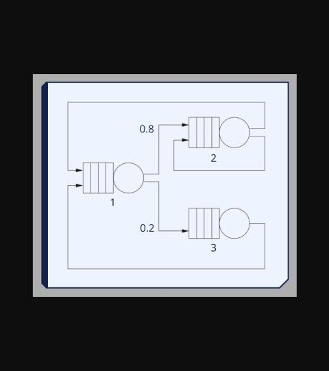
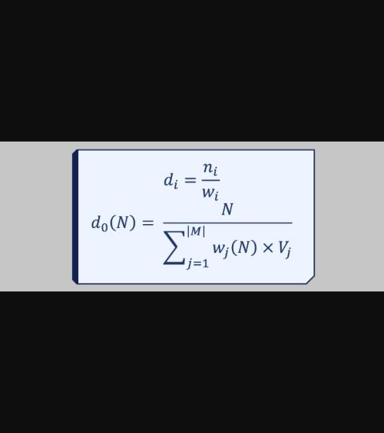
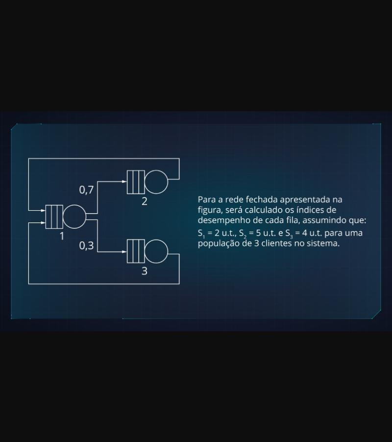

# M14 - Redes (fechadas) de filas de espera

Transcrição do texto multimodal do Moodle (Prof. Rafael Chanin). As fórmulas estavam
em imagens; aqui vão digitadas, com as imagens originais em `imagens/`.

## Taxas de visita

Igual às redes abertas, o primeiro passo é calcular as taxas de visita. A rede já é
fechada por definição, então não precisa da fila auxiliar X: vai direto para as
equações.



Exemplo (fila 1 → fila 2: 0,8; fila 1 → fila 3: 0,2; fila 2 → fila 1: 0,5;
fila 2 → fila 2: 0,5; fila 3 → fila 1: 1):

- V₃ = 0,2 × V₁ (a fila 3 recebe 20% dos clientes da fila 1)
- V₁ = V₃ + (0,5 × V₂) (a fila 1 recebe tudo que sai da 3 e metade do que sai da 2)
- V₂ = (0,8 × V₁) + (0,5 × V₂) (a fila 2 recebe 80% da 1 e metade do que sai dela mesma)


O sistema é **indeterminado**: como a taxa de visita é uma proporção, assume-se um
valor para uma fila (ex.: **V₁ = 1**) e calculam-se as outras a partir dele.
No exemplo: V₁ = 1, V₃ = 0,2, V₂ = 1,6.


## Índices de desempenho dependem de N

Em rede fechada não há entradas: N clientes "habitam" a rede. Os índices são
calculados em função de N, de forma incremental (N = 1, 2, 3, ...).

- Ponto de partida: **nᵢ(0) = 0** (com 0 clientes, toda fila está vazia).
- **Teorema da Chegada:** o tempo de resposta de quem chega depende da população
  que ele encontra na fila. Com 1 cliente: wᵢ(1) = Sᵢ × (1 + nᵢ(0)).

## Fórmulas (MVA — Mean-Value Analysis, Reiser e Lavenberg)

| Índice | Fórmula |
|---|---|
| Tempo de resposta | **wᵢ(N) = Sᵢ × (1 + nᵢ(N − 1))** |
| Vazão da rede inteira | **d₀(N) = N / Σⱼ (wⱼ(N) × Vⱼ)** |
| Vazão da fila i | **dᵢ(N) = d₀(N) × Vᵢ** |
| População da fila i | **nᵢ(N) = wᵢ(N) × dᵢ(N)** (Lei de Little) |
| Utilização da fila i | **uᵢ = dᵢ(N) × Sᵢ** (mesma da rede aberta) |



Intuição do d₀: a rede inteira vira "uma fila só" com população N; o tempo de
resposta dela é a média ponderada dos wⱼ pelas taxas de visita. Lei de Little:
d = n / w.

**Conferência:** Σ nᵢ(N) tem que dar N (aproximadamente, por arredondamento).

## Exemplo resolvido (image slider do M14)

Rede: fila 1 → 2 (0,7), fila 1 → 3 (0,3), filas 2 e 3 voltam para a 1.
S₁ = 2, S₂ = 5, S₃ = 4 u.t., N = 3 clientes.



V₁ = 1, V₂ = 0,7, V₃ = 0,3. n₁(0) = n₂(0) = n₃(0) = 0.

**N = 1**

```
w1(1) = S1 × (1 + n1(0)) = 2 × (1 + 0) = 2
w2(1) = 5 × (1 + 0) = 5
w3(1) = 4 × (1 + 0) = 4
d0(1) = 1 / ((2 × 1) + (5 × 0,7) + (4 × 0,3)) = 1 / 6,7 = 0,1493
d1(1) = 0,1493 × 1 = 0,1493     n1(1) = 2 × 0,1493 = 0,2986
d2(1) = 0,1493 × 0,7 = 0,1045   n2(1) = 5 × 0,1045 = 0,5225
d3(1) = 0,1493 × 0,3 = 0,0448   n3(1) = 4 × 0,0448 = 0,1792
```

Σ n(1) ≈ 1 ✓

**N = 2**

```
w1(2) = 2 × (1 + 0,2986) = 2,5972
w2(2) = 5 × (1 + 0,5225) = 7,6125
w3(2) = 4 × (1 + 0,1792) = 4,7168
d0(2) = 2 / ((2,5972 × 1) + (7,6125 × 0,7) + (4,7168 × 0,3)) = 2 / 9,3410 = 0,2141
d1(2) = 0,2141   n1(2) = 2,5972 × 0,2141 = 0,5561
d2(2) = 0,1499   n2(2) = 7,6125 × 0,1499 = 1,1411
d3(2) = 0,0642   n3(2) = 4,7168 × 0,0642 = 0,3028
```

**N = 3**

```
w1(3) = 2 × (1 + 0,5561) = 3,1122
w2(3) = 5 × (1 + 1,1411) = 10,7055
w3(3) = 4 × (1 + 0,3028) = 5,2112
d0(3) = 3 / ((3,1122 × 1) + (10,7055 × 0,7) + (5,2112 × 0,3)) = 3 / 12,1694 = 0,2465
d1(3) = 0,2465   n1(3) = 0,7672
d2(3) = 0,1726   n2(3) = 1,8478
d3(3) = 0,0740   n3(3) = 0,3856
```

Σ n(3) ≈ 3 ✓

Imagens: [N = 1](imagens/06-exemplo-mva-n1.jpg), [conferência](imagens/07-exemplo-mva-conferencia.jpg),
[N = 2](imagens/08-exemplo-mva-n2.jpg), [N = 3](imagens/09-exemplo-mva-n3.jpg).
